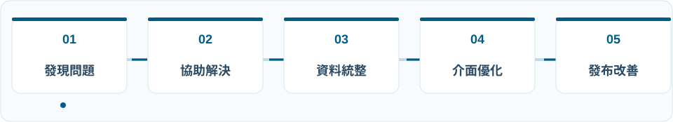

<!-- MinXuan GitHub Profile | GitHub-compatible Markdown & self-hosted animated SVG assets -->

  
  
  
  

🌐 <a href="./README.md"><strong>繁體中文</strong></a> &nbsp; | &nbsp; <a href="./languages/en.md">English</a> &nbsp; | &nbsp; <a href="./languages/ja.md">日本語</a> &nbsp; | &nbsp; <a href="./languages/ko.md">한국어</a>

##  關於我

網站開發者、數位創作者，也是 **琉急式 LiuqiuNow** 的創辦人。從臺灣屏東小琉球出發，持續探索網站開發、資訊系統、攝影與介面設計。

我喜歡觀察生活中真正需要被改善的問題，透過蒐集資料、整合資訊與設計容易理解的操作介面，讓複雜的事情變簡單。

目前專注於 **琉急式 LiuqiuNow** 的開發與經營，把小琉球船班、海況、船舶動態與在地生活資訊整合成實際可使用的服務。我也喜歡攝影、影像後製與視覺設計，希望每件作品都不只是好看，更能幫助別人。

##  技術與工具

<table>
<tr>
<td width="50%" valign="top"><strong>前端技術</strong>
 HTML5&nbsp; &nbsp;  CSS3&nbsp; &nbsp;  JavaScript&nbsp; &nbsp;  RWD
</td>
<td width="50%" valign="top"><strong>開發與部署</strong>
 VS Code&nbsp; &nbsp;  Git&nbsp; &nbsp;  GitHub&nbsp; &nbsp;  Cloudflare&nbsp; &nbsp;  Cloudflare Workers
</td>
</tr>
<tr>
<td width="50%" valign="top"><strong>資料與系統整合</strong>
 Google Apps Script&nbsp; &nbsp;  REST API&nbsp; &nbsp;  JSON&nbsp; &nbsp;  Google Sheets&nbsp; &nbsp;  PWA
</td>
<td width="50%" valign="top"><strong>設計與影像</strong>
 Photoshop&nbsp; &nbsp;  Premiere Pro&nbsp; &nbsp;  Illustrator&nbsp; &nbsp;  Lightroom
</td>
</tr>
<tr>
<td width="50%" valign="top"><strong>網站優化能力</strong>
 SEO / GEO&nbsp; &nbsp;  UI/UX&nbsp; &nbsp;  Responsive Design&nbsp; &nbsp;  API Integration
</td>
<td width="50%" valign="top"><strong>持續學習與整合</strong>
 Python&nbsp; &nbsp;  Firebase
Python：學習中；Firebase：整合中。依實際經驗持續更新。</td>
</tr>
</table>

##  精選專案

###  琉急式｜LiuqiuNow

小琉球旅遊與生活即時資訊整合平台，讓旅客與在地居民更方便查詢需要的資訊。

**[liuqiunow.com](https://liuqiunow.com)**

<table>
<tr><td width="56" valign="middle"></td><td><strong>即時海況</strong> 整合小琉球海況、風力與海象預報資訊。 <a href="https://sea.liuqiunow.com">sea.liuqiunow.com</a></td></tr>
<tr><td width="56" valign="middle"></td><td><strong>即時船班</strong> 整理東港與小琉球的航班、異動與乘船資訊。 <a href="https://ferry.liuqiunow.com">ferry.liuqiunow.com</a></td></tr>
<tr><td width="56" valign="middle"></td><td><strong>即時船舶</strong> 以地圖方式呈現船舶位置及航行動態。 <a href="https://ships.liuqiunow.com">ships.liuqiunow.com</a></td></tr>
</table>

##  我的開發流程

先觀察實際需求、找到能幫助別人的解法，再核對並整合資料，設計直覺易用的介面；上線後依據回饋持續更新。

##  開發紀錄

在 GitHub 記錄網站開發、資訊整合與工具實作的過程。比起單純累積專案數量，我更在意作品能不能真正解決問題。

**[查看 GitHub 儲存庫](https://github.com/hehe6272?tab=repositories)**

##  與我連結

  <a href="https://minxuan.pages.dev/">個人網站</a> &nbsp;·&nbsp;
  <a href="https://liuqiunow.com">LiuqiuNow</a> &nbsp;·&nbsp;
  <a href="https://youtube.com/@MinXuan_tw">YouTube</a> &nbsp;·&nbsp;
  <a href="https://github.com/hehe6272">GitHub</a>

Discord: .minxuan20061009

讓每一個想法，變成真正有用的工具。

