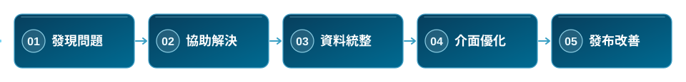

<!-- MinXuan profile V7 | compact, readable, GitHub-compatible -->

<h1 align="center">嗨，我是玟珄</h1>

來自臺灣屏東小琉球的網站開發者。喜歡把資訊、設計與程式結合，做出真正有用的數位工具。

   

🌐 <a href="README.md"><strong>繁體中文</strong></a>　·　<a href="languages/en.md">English</a>　·　<a href="languages/ja.md">日本語</a>　·　<a href="languages/ko.md">한국어</a>

---

## 關於我

我是一位網站開發者與數位創作者，也是 **琉急式 LiuqiuNow** 的創辦人。現在持續整合小琉球的旅遊與在地生活資訊，讓原本分散的資料更容易查詢與使用。

除了網站與資訊系統，我也喜歡攝影、影像後製與 UI/UX 設計。我的目標不只是完成一個網站，而是讓作品能實際幫助別人。

## 技術與工具

<table>
<tr>
<td width="50%" valign="top">
<strong>前端技術</strong>

 HTML5 &nbsp; · &nbsp;  CSS3 &nbsp; · &nbsp;  JavaScript &nbsp; · &nbsp;  RWD

</td>
<td width="50%" valign="top">
<strong>開發與部署</strong>

 VS Code &nbsp; · &nbsp;  Git &nbsp; · &nbsp;  GitHub &nbsp; · &nbsp;  Cloudflare &nbsp; · &nbsp;  Workers

</td>
</tr>
<tr>
<td width="50%" valign="top">
<strong>資料與系統整合</strong>

 Apps Script &nbsp; · &nbsp;  REST API &nbsp; · &nbsp;  JSON &nbsp; · &nbsp;  Google Sheets &nbsp; · &nbsp;  PWA

</td>
<td width="50%" valign="top">
<strong>設計與影像</strong>

 Photoshop &nbsp; · &nbsp;  Premiere Pro &nbsp; · &nbsp;  Illustrator &nbsp; · &nbsp;  Lightroom

</td>
</tr>
<tr>
<td width="50%" valign="top">
<strong>網站優化</strong>

 SEO / GEO &nbsp; · &nbsp;  UI/UX &nbsp; · &nbsp;  Responsive Design &nbsp; · &nbsp;  API Integration

</td>
<td width="50%" valign="top">
<strong>持續學習</strong>

 Python &nbsp; · &nbsp;  Firebase

Python：學習中；Firebase：整合中。
</td>
</tr>
</table>

## 精選專案

以 **琉急式 LiuqiuNow** 為核心，持續開發小琉球即時資訊服務。

-  **[琉急式｜LiuqiuNow](https://liuqiunow.com)** — 小琉球旅遊與在地生活資訊整合平台
- **[即時海況](https://sea.liuqiunow.com)** — 海況、風力與海象預報
- **[即時船班](https://ferry.liuqiunow.com)** — 東港與小琉球航班資訊及異動
- **[即時船舶](https://ships.liuqiunow.com)** — 船舶位置、地圖與航行動態

## 我的開發流程

從觀察實際需求開始，找到能協助別人的解決方式，再核對、整合資訊，設計更容易使用的介面，最後發布並依回饋持續更新。

## 開發紀錄

在 GitHub 記錄網站開發、資料整合與實用工具。比起堆疊專案數量，我更在意作品是否真的解決問題。 **[查看 GitHub 儲存庫](https://github.com/hehe6272?tab=repositories)**

## 與我連結

<a href="https://minxuan.pages.dev/">個人網站</a> · <a href="https://liuqiunow.com">LiuqiuNow</a> · <a href="https://youtube.com/@MinXuan_tw">YouTube</a> · <a href="https://github.com/hehe6272">GitHub</a>

Discord: .minxuan20061009

把想法變成真正有用的工具。

