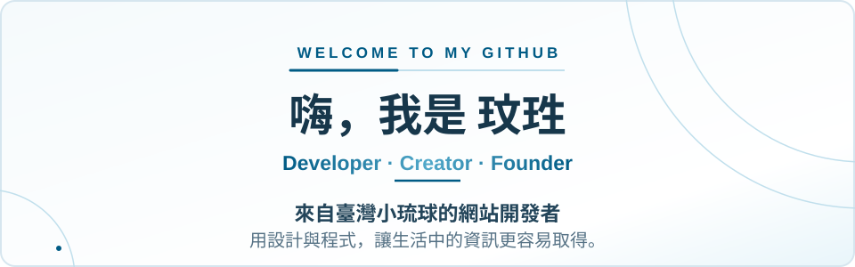

<!-- GitHub Profile V6 · self-hosted responsive light/dark visual system -->

<a href="https://minxuan.pages.dev/"><picture>
    <source media="(max-width: 600px) and (prefers-color-scheme: dark)" srcset="./assets/v6/hero-zh-mobile-dark.svg">
    <source media="(max-width: 600px)" srcset="./assets/v6/hero-zh-mobile-light.svg">
    <source media="(prefers-color-scheme: dark)" srcset="./assets/v6/hero-zh-desktop-dark.svg">
    
  </picture></a>

   

🌐 &nbsp; <a href="./README.md"><strong>繁體中文</strong></a> &nbsp;·&nbsp; <a href="./languages/en.md">English</a> &nbsp;·&nbsp; <a href="./languages/ja.md">日本語</a> &nbsp;·&nbsp; <a href="./languages/ko.md">한국어</a>

## 關於我

我來自臺灣屏東小琉球，是網站開發者、數位創作者，也是 **琉急式 LiuqiuNow** 的創辦人。喜歡把分散的資訊整理成清楚、好用的數位服務。

目前持續開發小琉球即時資訊平台，涵蓋船班、海況、船舶動態與在地生活資訊。除了程式設計，我也投入攝影、影像後製與 UI/UX 設計，希望作品不只好看，更能真正幫助使用者。

<picture>
    <source media="(max-width: 600px) and (prefers-color-scheme: dark)" srcset="./assets/v6/divider-mobile-dark.svg">
    <source media="(max-width: 600px)" srcset="./assets/v6/divider-mobile-light.svg">
    <source media="(prefers-color-scheme: dark)" srcset="./assets/v6/divider-desktop-dark.svg">
    
  </picture>

## 技術與工具

### 前端技術

<picture>
    <source media="(max-width: 600px) and (prefers-color-scheme: dark)" srcset="./assets/v6/tech-1-mobile-dark.svg">
    <source media="(max-width: 600px)" srcset="./assets/v6/tech-1-mobile-light.svg">
    <source media="(prefers-color-scheme: dark)" srcset="./assets/v6/tech-1-desktop-dark.svg">
    
  </picture>

### 開發與部署

<picture>
    <source media="(max-width: 600px) and (prefers-color-scheme: dark)" srcset="./assets/v6/tech-2-mobile-dark.svg">
    <source media="(max-width: 600px)" srcset="./assets/v6/tech-2-mobile-light.svg">
    <source media="(prefers-color-scheme: dark)" srcset="./assets/v6/tech-2-desktop-dark.svg">
    
  </picture>

### 資料與系統整合

<picture>
    <source media="(max-width: 600px) and (prefers-color-scheme: dark)" srcset="./assets/v6/tech-3-mobile-dark.svg">
    <source media="(max-width: 600px)" srcset="./assets/v6/tech-3-mobile-light.svg">
    <source media="(prefers-color-scheme: dark)" srcset="./assets/v6/tech-3-desktop-dark.svg">
    
  </picture>

### 設計與影像

<picture>
    <source media="(max-width: 600px) and (prefers-color-scheme: dark)" srcset="./assets/v6/tech-4-mobile-dark.svg">
    <source media="(max-width: 600px)" srcset="./assets/v6/tech-4-mobile-light.svg">
    <source media="(prefers-color-scheme: dark)" srcset="./assets/v6/tech-4-desktop-dark.svg">
    
  </picture>

### 網站優化

<picture>
    <source media="(max-width: 600px) and (prefers-color-scheme: dark)" srcset="./assets/v6/tech-5-mobile-dark.svg">
    <source media="(max-width: 600px)" srcset="./assets/v6/tech-5-mobile-light.svg">
    <source media="(prefers-color-scheme: dark)" srcset="./assets/v6/tech-5-desktop-dark.svg">
    
  </picture>

### 持續學習

<picture>
    <source media="(max-width: 600px) and (prefers-color-scheme: dark)" srcset="./assets/v6/tech-6-mobile-dark.svg">
    <source media="(max-width: 600px)" srcset="./assets/v6/tech-6-mobile-light.svg">
    <source media="(prefers-color-scheme: dark)" srcset="./assets/v6/tech-6-desktop-dark.svg">
    
  </picture>

Python 持續學習中；Firebase 正在整合與實作中。

<picture>
    <source media="(max-width: 600px) and (prefers-color-scheme: dark)" srcset="./assets/v6/divider-mobile-dark.svg">
    <source media="(max-width: 600px)" srcset="./assets/v6/divider-mobile-light.svg">
    <source media="(prefers-color-scheme: dark)" srcset="./assets/v6/divider-desktop-dark.svg">
    
  </picture>

## 精選專案

### 琉急式 · LiuqiuNow

小琉球旅遊與生活即時資訊整合平台，讓重要資訊更容易查詢、更容易理解。

<a href="https://liuqiunow.com"><picture>
    <source media="(max-width: 600px) and (prefers-color-scheme: dark)" srcset="./assets/v6/featured-mobile-dark.svg">
    <source media="(max-width: 600px)" srcset="./assets/v6/featured-mobile-light.svg">
    <source media="(prefers-color-scheme: dark)" srcset="./assets/v6/featured-desktop-dark.svg">
    
  </picture></a>

#### [即時海況](https://sea.liuqiunow.com)

<a href="https://sea.liuqiunow.com"><picture>
    <source media="(max-width: 600px) and (prefers-color-scheme: dark)" srcset="./assets/v6/project-1-mobile-dark.svg">
    <source media="(max-width: 600px)" srcset="./assets/v6/project-1-mobile-light.svg">
    <source media="(prefers-color-scheme: dark)" srcset="./assets/v6/project-1-desktop-dark.svg">
    
  </picture></a>

整合海況、風力與海象預報資訊。

#### [即時船班](https://ferry.liuqiunow.com)

<a href="https://ferry.liuqiunow.com"><picture>
    <source media="(max-width: 600px) and (prefers-color-scheme: dark)" srcset="./assets/v6/project-2-mobile-dark.svg">
    <source media="(max-width: 600px)" srcset="./assets/v6/project-2-mobile-light.svg">
    <source media="(prefers-color-scheme: dark)" srcset="./assets/v6/project-2-desktop-dark.svg">
    
  </picture></a>

提供船班查詢、航班異動與乘船資訊。

#### [即時船舶](https://ships.liuqiunow.com)

<a href="https://ships.liuqiunow.com"><picture>
    <source media="(max-width: 600px) and (prefers-color-scheme: dark)" srcset="./assets/v6/project-3-mobile-dark.svg">
    <source media="(max-width: 600px)" srcset="./assets/v6/project-3-mobile-light.svg">
    <source media="(prefers-color-scheme: dark)" srcset="./assets/v6/project-3-desktop-dark.svg">
    
  </picture></a>

透過地圖展示船位與航行動態。

<picture>
    <source media="(max-width: 600px) and (prefers-color-scheme: dark)" srcset="./assets/v6/divider-mobile-dark.svg">
    <source media="(max-width: 600px)" srcset="./assets/v6/divider-mobile-light.svg">
    <source media="(prefers-color-scheme: dark)" srcset="./assets/v6/divider-desktop-dark.svg">
    
  </picture>

## 我的開發流程

<picture>
    <source media="(max-width: 600px) and (prefers-color-scheme: dark)" srcset="./assets/v6/workflow-mobile-dark.svg">
    <source media="(max-width: 600px)" srcset="./assets/v6/workflow-mobile-light.svg">
    <source media="(prefers-color-scheme: dark)" srcset="./assets/v6/workflow-desktop-dark.svg">
    
  </picture>

**發現問題 → 協助解決 → 資料統整 → 介面優化 → 發布改善**

從觀察真實需求開始，協助找到解決方式；接著整理與驗證資料，設計直覺的操作介面，最後發布並持續依使用者回饋改善。

<picture>
    <source media="(max-width: 600px) and (prefers-color-scheme: dark)" srcset="./assets/v6/divider-mobile-dark.svg">
    <source media="(max-width: 600px)" srcset="./assets/v6/divider-mobile-light.svg">
    <source media="(prefers-color-scheme: dark)" srcset="./assets/v6/divider-desktop-dark.svg">
    
  </picture>

## 開發紀錄

我在 GitHub 紀錄網站開發、系統整合與實用工具的製作過程。對我來說，比專案數量更重要的是作品能否真正解決問題。

**[查看我的 GitHub 儲存庫](https://github.com/hehe6272?tab=repositories)**

## 與我連結

<a href="https://minxuan.pages.dev/">個人網站</a> &nbsp;·&nbsp; <a href="https://liuqiunow.com">LiuqiuNow</a> &nbsp;·&nbsp; <a href="https://youtube.com/@MinXuan_tw">YouTube</a> &nbsp;·&nbsp; <a href="https://github.com/hehe6272">GitHub</a>

Discord: .minxuan20061009

<picture>
    <source media="(max-width: 600px) and (prefers-color-scheme: dark)" srcset="./assets/v6/footer-mobile-dark.svg">
    <source media="(max-width: 600px)" srcset="./assets/v6/footer-mobile-light.svg">
    <source media="(prefers-color-scheme: dark)" srcset="./assets/v6/footer-desktop-dark.svg">
    
  </picture>

把想法變成真正有用的工具。

