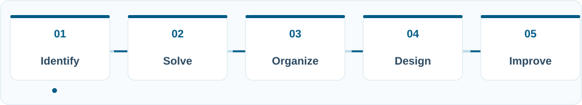

<!-- MinXuan GitHub Profile | GitHub-compatible Markdown & self-hosted animated SVG assets -->

  
  
  
  

🌐 <a href="../README.md">繁體中文</a> &nbsp; | &nbsp; <a href="./en.md"><strong>English</strong></a> &nbsp; | &nbsp; <a href="./ja.md">日本語</a> &nbsp; | &nbsp; <a href="./ko.md">한국어</a>

##  About Me

I'm a web developer and digital creator from Xiaoliuqiu, Taiwan, and the founder of **LiuqiuNow**. I enjoy building websites, information systems, and thoughtful digital experiences.

I pay attention to real problems people encounter, then turn scattered information into accessible, intuitive digital tools through research, data integration, and design.

I'm currently developing **LiuqiuNow**, combining Xiaoliuqiu ferry schedules, sea conditions, live vessel tracking, and useful local information. I'm also passionate about photography, photo editing, and visual design. For me, great products should look good and genuinely help people.

##  Tech Stack & Tools

<table>
<tr>
<td width="50%" valign="top"><strong>Frontend</strong>
 HTML5&nbsp; &nbsp;  CSS3&nbsp; &nbsp;  JavaScript&nbsp; &nbsp;  RWD
</td>
<td width="50%" valign="top"><strong>Development &amp; Deployment</strong>
 VS Code&nbsp; &nbsp;  Git&nbsp; &nbsp;  GitHub&nbsp; &nbsp;  Cloudflare&nbsp; &nbsp;  Cloudflare Workers
</td>
</tr>
<tr>
<td width="50%" valign="top"><strong>Data &amp; Integration</strong>
 Google Apps Script&nbsp; &nbsp;  REST API&nbsp; &nbsp;  JSON&nbsp; &nbsp;  Google Sheets&nbsp; &nbsp;  PWA
</td>
<td width="50%" valign="top"><strong>Design &amp; Media</strong>
 Photoshop&nbsp; &nbsp;  Premiere Pro&nbsp; &nbsp;  Illustrator&nbsp; &nbsp;  Lightroom
</td>
</tr>
<tr>
<td width="50%" valign="top"><strong>Web Optimization</strong>
 SEO / GEO&nbsp; &nbsp;  UI/UX&nbsp; &nbsp;  Responsive Design&nbsp; &nbsp;  API Integration
</td>
<td width="50%" valign="top"><strong>Learning &amp; Integration</strong>
 Python&nbsp; &nbsp;  Firebase
Python: learning; Firebase: integrating. Updated as my experience grows.</td>
</tr>
</table>

##  Featured Projects

###  琉急式｜LiuqiuNow

A real-time local information platform helping Xiaoliuqiu travelers and residents find useful travel and lifestyle information.

**[liuqiunow.com](https://liuqiunow.com)**

<table>
<tr><td width="56" valign="middle"></td><td><strong>Live Sea Conditions</strong> Local sea, wind, and marine forecast information. <a href="https://sea.liuqiunow.com">sea.liuqiunow.com</a></td></tr>
<tr><td width="56" valign="middle"></td><td><strong>Live Ferry Schedules</strong> Ferry services, changes, and passenger information. <a href="https://ferry.liuqiunow.com">ferry.liuqiunow.com</a></td></tr>
<tr><td width="56" valign="middle"></td><td><strong>Live Vessels</strong> Map-based vessel positions and movements. <a href="https://ships.liuqiunow.com">ships.liuqiunow.com</a></td></tr>
</table>

##  Development Process

Identify real needs, develop practical solutions, verify and organize the data, design intuitive interfaces, and continue improving after launch.

##  Development Activity

I use GitHub to document web development, information integration, and practical tools. More than collecting projects, I care about solving real problems.

**[View GitHub Repositories](https://github.com/hehe6272?tab=repositories)**

##  Connect

  <a href="https://minxuan.pages.dev/">Personal Website</a> &nbsp;·&nbsp;
  <a href="https://liuqiunow.com">LiuqiuNow</a> &nbsp;·&nbsp;
  <a href="https://youtube.com/@MinXuan_tw">YouTube</a> &nbsp;·&nbsp;
  <a href="https://github.com/hehe6272">GitHub</a>

Discord: .minxuan20061009

Turning good ideas into tools that make a difference.

