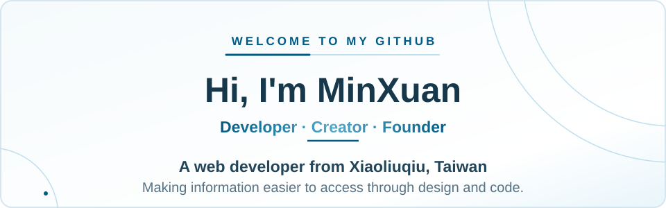
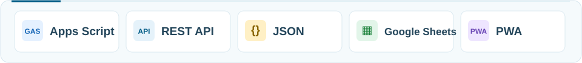

<!-- GitHub Profile V6 · self-hosted responsive light/dark visual system -->

<a href="https://minxuan.pages.dev/"><picture>
    <source media="(max-width: 600px) and (prefers-color-scheme: dark)" srcset="../assets/v6/hero-en-mobile-dark.svg">
    <source media="(max-width: 600px)" srcset="../assets/v6/hero-en-mobile-light.svg">
    <source media="(prefers-color-scheme: dark)" srcset="../assets/v6/hero-en-desktop-dark.svg">
    
  </picture></a>

   

🌐 &nbsp; <a href="../README.md">繁體中文</a> &nbsp;·&nbsp; <a href="./en.md"><strong>English</strong></a> &nbsp;·&nbsp; <a href="./ja.md">日本語</a> &nbsp;·&nbsp; <a href="./ko.md">한국어</a>

## About Me

I'm a web developer and digital creator from Xiaoliuqiu, Pingtung, Taiwan, and the founder of **LiuqiuNow**. I enjoy turning scattered information into clear and useful digital experiences.

I'm developing a local real-time information platform for ferries, sea conditions, vessel tracking, and island life. Beyond coding, I'm interested in photography, image editing, and UI/UX design. My goal is to build things that genuinely help people.

<picture>
    <source media="(max-width: 600px) and (prefers-color-scheme: dark)" srcset="../assets/v6/divider-mobile-dark.svg">
    <source media="(max-width: 600px)" srcset="../assets/v6/divider-mobile-light.svg">
    <source media="(prefers-color-scheme: dark)" srcset="../assets/v6/divider-desktop-dark.svg">
    
  </picture>

## Tech Stack & Tools

### Frontend

<picture>
    <source media="(max-width: 600px) and (prefers-color-scheme: dark)" srcset="../assets/v6/tech-1-mobile-dark.svg">
    <source media="(max-width: 600px)" srcset="../assets/v6/tech-1-mobile-light.svg">
    <source media="(prefers-color-scheme: dark)" srcset="../assets/v6/tech-1-desktop-dark.svg">
    
  </picture>

### Development & Deployment

<picture>
    <source media="(max-width: 600px) and (prefers-color-scheme: dark)" srcset="../assets/v6/tech-2-mobile-dark.svg">
    <source media="(max-width: 600px)" srcset="../assets/v6/tech-2-mobile-light.svg">
    <source media="(prefers-color-scheme: dark)" srcset="../assets/v6/tech-2-desktop-dark.svg">
    
  </picture>

### Data & Integration

<picture>
    <source media="(max-width: 600px) and (prefers-color-scheme: dark)" srcset="../assets/v6/tech-3-mobile-dark.svg">
    <source media="(max-width: 600px)" srcset="../assets/v6/tech-3-mobile-light.svg">
    <source media="(prefers-color-scheme: dark)" srcset="../assets/v6/tech-3-desktop-dark.svg">
    
  </picture>

### Design & Media

<picture>
    <source media="(max-width: 600px) and (prefers-color-scheme: dark)" srcset="../assets/v6/tech-4-mobile-dark.svg">
    <source media="(max-width: 600px)" srcset="../assets/v6/tech-4-mobile-light.svg">
    <source media="(prefers-color-scheme: dark)" srcset="../assets/v6/tech-4-desktop-dark.svg">
    
  </picture>

### Web Optimization

<picture>
    <source media="(max-width: 600px) and (prefers-color-scheme: dark)" srcset="../assets/v6/tech-5-mobile-dark.svg">
    <source media="(max-width: 600px)" srcset="../assets/v6/tech-5-mobile-light.svg">
    <source media="(prefers-color-scheme: dark)" srcset="../assets/v6/tech-5-desktop-dark.svg">
    
  </picture>

### Currently Learning

<picture>
    <source media="(max-width: 600px) and (prefers-color-scheme: dark)" srcset="../assets/v6/tech-6-mobile-dark.svg">
    <source media="(max-width: 600px)" srcset="../assets/v6/tech-6-mobile-light.svg">
    <source media="(prefers-color-scheme: dark)" srcset="../assets/v6/tech-6-desktop-dark.svg">
    
  </picture>

Python: learning · Firebase: integration in progress.

<picture>
    <source media="(max-width: 600px) and (prefers-color-scheme: dark)" srcset="../assets/v6/divider-mobile-dark.svg">
    <source media="(max-width: 600px)" srcset="../assets/v6/divider-mobile-light.svg">
    <source media="(prefers-color-scheme: dark)" srcset="../assets/v6/divider-desktop-dark.svg">
    
  </picture>

## Featured Projects

### 琉急式 · LiuqiuNow

An integrated real-time travel and local information platform designed to make Xiaoliuqiu easier to explore.

<a href="https://liuqiunow.com"><picture>
    <source media="(max-width: 600px) and (prefers-color-scheme: dark)" srcset="../assets/v6/featured-mobile-dark.svg">
    <source media="(max-width: 600px)" srcset="../assets/v6/featured-mobile-light.svg">
    <source media="(prefers-color-scheme: dark)" srcset="../assets/v6/featured-desktop-dark.svg">
    
  </picture></a>

#### [Live Sea Conditions](https://sea.liuqiunow.com)

<a href="https://sea.liuqiunow.com"><picture>
    <source media="(max-width: 600px) and (prefers-color-scheme: dark)" srcset="../assets/v6/project-1-mobile-dark.svg">
    <source media="(max-width: 600px)" srcset="../assets/v6/project-1-mobile-light.svg">
    <source media="(prefers-color-scheme: dark)" srcset="../assets/v6/project-1-desktop-dark.svg">
    
  </picture></a>

Marine conditions, winds and forecasts.

#### [Live Ferry Schedules](https://ferry.liuqiunow.com)

<a href="https://ferry.liuqiunow.com"><picture>
    <source media="(max-width: 600px) and (prefers-color-scheme: dark)" srcset="../assets/v6/project-2-mobile-dark.svg">
    <source media="(max-width: 600px)" srcset="../assets/v6/project-2-mobile-light.svg">
    <source media="(prefers-color-scheme: dark)" srcset="../assets/v6/project-2-desktop-dark.svg">
    
  </picture></a>

Schedules, service updates and travel info.

#### [Live Vessels](https://ships.liuqiunow.com)

<a href="https://ships.liuqiunow.com"><picture>
    <source media="(max-width: 600px) and (prefers-color-scheme: dark)" srcset="../assets/v6/project-3-mobile-dark.svg">
    <source media="(max-width: 600px)" srcset="../assets/v6/project-3-mobile-light.svg">
    <source media="(prefers-color-scheme: dark)" srcset="../assets/v6/project-3-desktop-dark.svg">
    
  </picture></a>

Vessel positions and movements on a map.

<picture>
    <source media="(max-width: 600px) and (prefers-color-scheme: dark)" srcset="../assets/v6/divider-mobile-dark.svg">
    <source media="(max-width: 600px)" srcset="../assets/v6/divider-mobile-light.svg">
    <source media="(prefers-color-scheme: dark)" srcset="../assets/v6/divider-desktop-dark.svg">
    
  </picture>

## Development Process

<picture>
    <source media="(max-width: 600px) and (prefers-color-scheme: dark)" srcset="../assets/v6/workflow-mobile-dark.svg">
    <source media="(max-width: 600px)" srcset="../assets/v6/workflow-mobile-light.svg">
    <source media="(prefers-color-scheme: dark)" srcset="../assets/v6/workflow-desktop-dark.svg">
    
  </picture>

**Identify → Solve → Organize → Design → Improve**

I identify practical needs, develop solutions, collect and verify data, design easy-to-use interfaces, and keep improving after launch.

<picture>
    <source media="(max-width: 600px) and (prefers-color-scheme: dark)" srcset="../assets/v6/divider-mobile-dark.svg">
    <source media="(max-width: 600px)" srcset="../assets/v6/divider-mobile-light.svg">
    <source media="(prefers-color-scheme: dark)" srcset="../assets/v6/divider-desktop-dark.svg">
    
  </picture>

## Development Activity

My GitHub documents website development, data integration, and practical tools. I care more about solving real problems than collecting repositories.

**[Explore GitHub Repositories](https://github.com/hehe6272?tab=repositories)**

## Connect

<a href="https://minxuan.pages.dev/">Personal Website</a> &nbsp;·&nbsp; <a href="https://liuqiunow.com">LiuqiuNow</a> &nbsp;·&nbsp; <a href="https://youtube.com/@MinXuan_tw">YouTube</a> &nbsp;·&nbsp; <a href="https://github.com/hehe6272">GitHub</a>

Discord: .minxuan20061009

<picture>
    <source media="(max-width: 600px) and (prefers-color-scheme: dark)" srcset="../assets/v6/footer-mobile-dark.svg">
    <source media="(max-width: 600px)" srcset="../assets/v6/footer-mobile-light.svg">
    <source media="(prefers-color-scheme: dark)" srcset="../assets/v6/footer-desktop-dark.svg">
    
  </picture>

Turning ideas into tools that matter.

