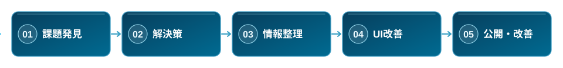

<!-- MinXuan profile V7 | compact, readable, GitHub-compatible -->

<h1 align="center">こんにちは、玟珄です</h1>

台湾・小琉球出身のウェブ開発者。情報、デザイン、コードを組み合わせて、役立つデジタルツールを作っています。

   

🌐 <a href="../README.md">繁體中文</a>　·　<a href="en.md">English</a>　·　<a href="ja.md"><strong>日本語</strong></a>　·　<a href="ko.md">한국어</a>

---

## 自己紹介

台湾・小琉球出身のウェブ開発者・デジタルクリエイターで、**LiuqiuNow** の創設者です。地域の旅行・生活情報を一つにまとめ、誰もが使いやすいサービスを目指しています。

写真撮影、画像編集、UI/UX デザインにも関心があります。ウェブサイトを完成させるだけでなく、人の役に立つ作品を作りたいと考えています。

## 技術とツール

<table>
<tr>
<td width="50%" valign="top">
<strong>フロントエンド</strong>

 HTML5 &nbsp; · &nbsp;  CSS3 &nbsp; · &nbsp;  JavaScript &nbsp; · &nbsp;  RWD

</td>
<td width="50%" valign="top">
<strong>開発とデプロイ</strong>

 VS Code &nbsp; · &nbsp;  Git &nbsp; · &nbsp;  GitHub &nbsp; · &nbsp;  Cloudflare &nbsp; · &nbsp;  Workers

</td>
</tr>
<tr>
<td width="50%" valign="top">
<strong>データ連携</strong>

 Apps Script &nbsp; · &nbsp;  REST API &nbsp; · &nbsp;  JSON &nbsp; · &nbsp;  Google Sheets &nbsp; · &nbsp;  PWA

</td>
<td width="50%" valign="top">
<strong>デザイン・映像</strong>

 Photoshop &nbsp; · &nbsp;  Premiere Pro &nbsp; · &nbsp;  Illustrator &nbsp; · &nbsp;  Lightroom

</td>
</tr>
<tr>
<td width="50%" valign="top">
<strong>ウェブ最適化</strong>

 SEO / GEO &nbsp; · &nbsp;  UI/UX &nbsp; · &nbsp;  Responsive Design &nbsp; · &nbsp;  API Integration

</td>
<td width="50%" valign="top">
<strong>学習・導入中</strong>

 Python &nbsp; · &nbsp;  Firebase

Python：学習中；Firebase：連携・導入中。
</td>
</tr>
</table>

## 主なプロジェクト

小琉球の地域情報を提供する **LiuqiuNow** を中心に開発しています。

-  **[琉急式｜LiuqiuNow](https://liuqiunow.com)** — 旅行と地域生活の情報プラットフォーム
- **[リアルタイム海況](https://sea.liuqiunow.com)** — 海況・風・海上予報
- **[リアルタイム船便](https://ferry.liuqiunow.com)** — フェリー時刻と運航変更
- **[リアルタイム船舶](https://ships.liuqiunow.com)** — 船舶位置・地図・航行情報

## 開発プロセス

実際のニーズを発見し、役立つ解決策を考え、情報を整理・検証します。直感的なUIを設計した後も、公開と改善を続けます。

## 開発記録

GitHubでウェブ開発、データ連携、実用的なツールの制作過程を記録しています。実際に課題を解決することを大切にしています。 **[GitHubリポジトリを見る](https://github.com/hehe6272?tab=repositories)**

## リンク

<a href="https://minxuan.pages.dev/">個人サイト</a> · <a href="https://liuqiunow.com">LiuqiuNow</a> · <a href="https://youtube.com/@MinXuan_tw">YouTube</a> · <a href="https://github.com/hehe6272">GitHub</a>

Discord: .minxuan20061009

アイデアを、役立つツールへ。

