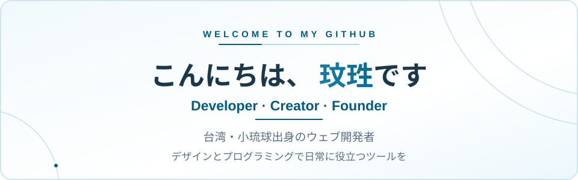
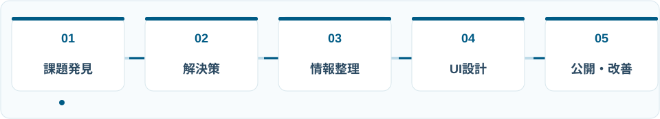

<!-- MinXuan GitHub Profile | GitHub-compatible Markdown & self-hosted animated SVG assets -->

  
  
  
  

🌐 <a href="../README.md">繁體中文</a> &nbsp; | &nbsp; <a href="./en.md">English</a> &nbsp; | &nbsp; <a href="./ja.md"><strong>日本語</strong></a> &nbsp; | &nbsp; <a href="./ko.md">한국어</a>

##  自己紹介

台湾・小琉球出身のウェブ開発者・デジタルクリエイターであり、**LiuqiuNow** の創設者です。ウェブサイト、情報システム、使いやすいデジタル体験の制作に取り組んでいます。

日常生活で実際に困っていることを見つけ、情報収集・データ連携・わかりやすいUIデザインを通じて、複雑な情報を使いやすいサービスに変えることが好きです。

現在は **LiuqiuNow** を開発・運営し、小琉球の船便、海況、船舶位置、地域の生活情報をまとめています。写真撮影、画像編集、ビジュアルデザインにも関心があり、見た目だけでなく本当に役に立つ作品を目指しています。

##  技術とツール

<table>
<tr>
<td width="50%" valign="top"><strong>フロントエンド</strong>
 HTML5&nbsp; &nbsp;  CSS3&nbsp; &nbsp;  JavaScript&nbsp; &nbsp;  RWD
</td>
<td width="50%" valign="top"><strong>開発とデプロイ</strong>
 VS Code&nbsp; &nbsp;  Git&nbsp; &nbsp;  GitHub&nbsp; &nbsp;  Cloudflare&nbsp; &nbsp;  Cloudflare Workers
</td>
</tr>
<tr>
<td width="50%" valign="top"><strong>データ連携</strong>
 Google Apps Script&nbsp; &nbsp;  REST API&nbsp; &nbsp;  JSON&nbsp; &nbsp;  Google Sheets&nbsp; &nbsp;  PWA
</td>
<td width="50%" valign="top"><strong>デザインと映像</strong>
 Photoshop&nbsp; &nbsp;  Premiere Pro&nbsp; &nbsp;  Illustrator&nbsp; &nbsp;  Lightroom
</td>
</tr>
<tr>
<td width="50%" valign="top"><strong>ウェブ最適化</strong>
 SEO / GEO&nbsp; &nbsp;  UI/UX&nbsp; &nbsp;  Responsive Design&nbsp; &nbsp;  API Integration
</td>
<td width="50%" valign="top"><strong>学習・導入中</strong>
 Python&nbsp; &nbsp;  Firebase
Python：学習中；Firebase：導入中。経験に応じて更新します。</td>
</tr>
</table>

##  主なプロジェクト

###  琉急式｜LiuqiuNow

小琉球の旅行者や住民が必要な情報を見つけやすくする、地域のリアルタイム情報プラットフォームです。

**[liuqiunow.com](https://liuqiunow.com)**

<table>
<tr><td width="56" valign="middle"></td><td><strong>リアルタイム海況</strong> 海況・風・海上予報を確認できます。 <a href="https://sea.liuqiunow.com">sea.liuqiunow.com</a></td></tr>
<tr><td width="56" valign="middle"></td><td><strong>リアルタイム船便</strong> フェリー時刻表や運航変更をまとめています。 <a href="https://ferry.liuqiunow.com">ferry.liuqiunow.com</a></td></tr>
<tr><td width="56" valign="middle"></td><td><strong>リアルタイム船舶</strong> 地図上で船舶の位置や動きを確認できます。 <a href="https://ships.liuqiunow.com">ships.liuqiunow.com</a></td></tr>
</table>

##  開発プロセス

実際のニーズを把握し、役立つ解決策を考え、情報を検証・統合して、直感的に使えるUIを設計します。公開後も改善を続けます。

##  開発記録

GitHubではウェブ開発、情報連携、便利なツールの制作過程を記録しています。数よりも、実際に課題を解決することを大切にしています。

**[GitHubリポジトリを見る](https://github.com/hehe6272?tab=repositories)**

##  リンク

  <a href="https://minxuan.pages.dev/">個人サイト</a> &nbsp;·&nbsp;
  <a href="https://liuqiunow.com">LiuqiuNow</a> &nbsp;·&nbsp;
  <a href="https://youtube.com/@MinXuan_tw">YouTube</a> &nbsp;·&nbsp;
  <a href="https://github.com/hehe6272">GitHub</a>

Discord: .minxuan20061009

アイデアを、暮らしに役立つツールへ。

