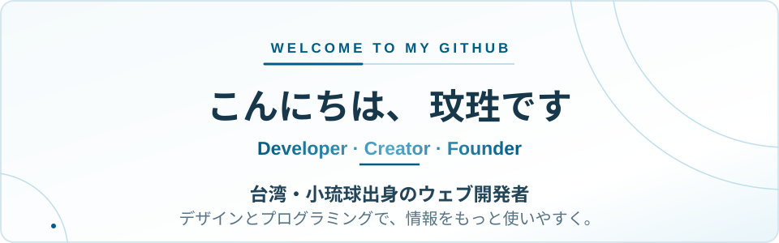

<!-- GitHub Profile V6 · self-hosted responsive light/dark visual system -->

<a href="https://minxuan.pages.dev/"><picture>
    <source media="(max-width: 600px) and (prefers-color-scheme: dark)" srcset="../assets/v6/hero-ja-mobile-dark.svg">
    <source media="(max-width: 600px)" srcset="../assets/v6/hero-ja-mobile-light.svg">
    <source media="(prefers-color-scheme: dark)" srcset="../assets/v6/hero-ja-desktop-dark.svg">
    
  </picture></a>

   

🌐 &nbsp; <a href="../README.md">繁體中文</a> &nbsp;·&nbsp; <a href="./en.md">English</a> &nbsp;·&nbsp; <a href="./ja.md"><strong>日本語</strong></a> &nbsp;·&nbsp; <a href="./ko.md">한국어</a>

## 自己紹介

台湾・屏東県の小琉球出身のウェブ開発者・デジタルクリエイターで、**LiuqiuNow** の創設者です。点在する情報を整理し、わかりやすいサービスにすることが好きです。

現在は船便、海況、船舶位置、地域の生活情報をまとめたリアルタイム情報サイトを開発しています。写真撮影や画像編集、UI/UX デザインにも取り組み、実際に人の役に立つ作品を目指しています。

<picture>
    <source media="(max-width: 600px) and (prefers-color-scheme: dark)" srcset="../assets/v6/divider-mobile-dark.svg">
    <source media="(max-width: 600px)" srcset="../assets/v6/divider-mobile-light.svg">
    <source media="(prefers-color-scheme: dark)" srcset="../assets/v6/divider-desktop-dark.svg">
    
  </picture>

## 技術とツール

### フロントエンド

<picture>
    <source media="(max-width: 600px) and (prefers-color-scheme: dark)" srcset="../assets/v6/tech-1-mobile-dark.svg">
    <source media="(max-width: 600px)" srcset="../assets/v6/tech-1-mobile-light.svg">
    <source media="(prefers-color-scheme: dark)" srcset="../assets/v6/tech-1-desktop-dark.svg">
    
  </picture>

### 開発とデプロイ

<picture>
    <source media="(max-width: 600px) and (prefers-color-scheme: dark)" srcset="../assets/v6/tech-2-mobile-dark.svg">
    <source media="(max-width: 600px)" srcset="../assets/v6/tech-2-mobile-light.svg">
    <source media="(prefers-color-scheme: dark)" srcset="../assets/v6/tech-2-desktop-dark.svg">
    
  </picture>

### データ・システム連携

<picture>
    <source media="(max-width: 600px) and (prefers-color-scheme: dark)" srcset="../assets/v6/tech-3-mobile-dark.svg">
    <source media="(max-width: 600px)" srcset="../assets/v6/tech-3-mobile-light.svg">
    <source media="(prefers-color-scheme: dark)" srcset="../assets/v6/tech-3-desktop-dark.svg">
    
  </picture>

### デザイン・映像

<picture>
    <source media="(max-width: 600px) and (prefers-color-scheme: dark)" srcset="../assets/v6/tech-4-mobile-dark.svg">
    <source media="(max-width: 600px)" srcset="../assets/v6/tech-4-mobile-light.svg">
    <source media="(prefers-color-scheme: dark)" srcset="../assets/v6/tech-4-desktop-dark.svg">
    
  </picture>

### ウェブ最適化

<picture>
    <source media="(max-width: 600px) and (prefers-color-scheme: dark)" srcset="../assets/v6/tech-5-mobile-dark.svg">
    <source media="(max-width: 600px)" srcset="../assets/v6/tech-5-mobile-light.svg">
    <source media="(prefers-color-scheme: dark)" srcset="../assets/v6/tech-5-desktop-dark.svg">
    
  </picture>

### 学習・導入中

<picture>
    <source media="(max-width: 600px) and (prefers-color-scheme: dark)" srcset="../assets/v6/tech-6-mobile-dark.svg">
    <source media="(max-width: 600px)" srcset="../assets/v6/tech-6-mobile-light.svg">
    <source media="(prefers-color-scheme: dark)" srcset="../assets/v6/tech-6-desktop-dark.svg">
    
  </picture>

Python：学習中 · Firebase：導入・連携中。

<picture>
    <source media="(max-width: 600px) and (prefers-color-scheme: dark)" srcset="../assets/v6/divider-mobile-dark.svg">
    <source media="(max-width: 600px)" srcset="../assets/v6/divider-mobile-light.svg">
    <source media="(prefers-color-scheme: dark)" srcset="../assets/v6/divider-desktop-dark.svg">
    
  </picture>

## 主なプロジェクト

### 琉急式 · LiuqiuNow

小琉球の旅行や地域生活に必要なリアルタイム情報をまとめたサービスです。

<a href="https://liuqiunow.com"><picture>
    <source media="(max-width: 600px) and (prefers-color-scheme: dark)" srcset="../assets/v6/featured-mobile-dark.svg">
    <source media="(max-width: 600px)" srcset="../assets/v6/featured-mobile-light.svg">
    <source media="(prefers-color-scheme: dark)" srcset="../assets/v6/featured-desktop-dark.svg">
    
  </picture></a>

#### [リアルタイム海況](https://sea.liuqiunow.com)

<a href="https://sea.liuqiunow.com"><picture>
    <source media="(max-width: 600px) and (prefers-color-scheme: dark)" srcset="../assets/v6/project-1-mobile-dark.svg">
    <source media="(max-width: 600px)" srcset="../assets/v6/project-1-mobile-light.svg">
    <source media="(prefers-color-scheme: dark)" srcset="../assets/v6/project-1-desktop-dark.svg">
    
  </picture></a>

海況・風・海上予報を確認できます。

#### [リアルタイム船便](https://ferry.liuqiunow.com)

<a href="https://ferry.liuqiunow.com"><picture>
    <source media="(max-width: 600px) and (prefers-color-scheme: dark)" srcset="../assets/v6/project-2-mobile-dark.svg">
    <source media="(max-width: 600px)" srcset="../assets/v6/project-2-mobile-light.svg">
    <source media="(prefers-color-scheme: dark)" srcset="../assets/v6/project-2-desktop-dark.svg">
    
  </picture></a>

船便時刻、運航変更、乗船情報。

#### [リアルタイム船舶](https://ships.liuqiunow.com)

<a href="https://ships.liuqiunow.com"><picture>
    <source media="(max-width: 600px) and (prefers-color-scheme: dark)" srcset="../assets/v6/project-3-mobile-dark.svg">
    <source media="(max-width: 600px)" srcset="../assets/v6/project-3-mobile-light.svg">
    <source media="(prefers-color-scheme: dark)" srcset="../assets/v6/project-3-desktop-dark.svg">
    
  </picture></a>

船舶の位置と動きを地図で表示。

<picture>
    <source media="(max-width: 600px) and (prefers-color-scheme: dark)" srcset="../assets/v6/divider-mobile-dark.svg">
    <source media="(max-width: 600px)" srcset="../assets/v6/divider-mobile-light.svg">
    <source media="(prefers-color-scheme: dark)" srcset="../assets/v6/divider-desktop-dark.svg">
    
  </picture>

## 開発プロセス

<picture>
    <source media="(max-width: 600px) and (prefers-color-scheme: dark)" srcset="../assets/v6/workflow-mobile-dark.svg">
    <source media="(max-width: 600px)" srcset="../assets/v6/workflow-mobile-light.svg">
    <source media="(prefers-color-scheme: dark)" srcset="../assets/v6/workflow-desktop-dark.svg">
    
  </picture>

**課題発見 → 解決策 → 情報整理 → UI設計 → 公開・改善**

日常の課題を発見し、解決策を考え、情報を整理・検証します。使いやすい画面を設計した後も、公開と改善を続けます。

<picture>
    <source media="(max-width: 600px) and (prefers-color-scheme: dark)" srcset="../assets/v6/divider-mobile-dark.svg">
    <source media="(max-width: 600px)" srcset="../assets/v6/divider-mobile-light.svg">
    <source media="(prefers-color-scheme: dark)" srcset="../assets/v6/divider-desktop-dark.svg">
    
  </picture>

## 開発記録

GitHubにはウェブ開発、システム連携、実用的なツールの制作記録を残しています。大切なのは、実際の課題を解決することです。

**[GitHubリポジトリを見る](https://github.com/hehe6272?tab=repositories)**

## リンク

<a href="https://minxuan.pages.dev/">個人サイト</a> &nbsp;·&nbsp; <a href="https://liuqiunow.com">LiuqiuNow</a> &nbsp;·&nbsp; <a href="https://youtube.com/@MinXuan_tw">YouTube</a> &nbsp;·&nbsp; <a href="https://github.com/hehe6272">GitHub</a>

Discord: .minxuan20061009

<picture>
    <source media="(max-width: 600px) and (prefers-color-scheme: dark)" srcset="../assets/v6/footer-mobile-dark.svg">
    <source media="(max-width: 600px)" srcset="../assets/v6/footer-mobile-light.svg">
    <source media="(prefers-color-scheme: dark)" srcset="../assets/v6/footer-desktop-dark.svg">
    
  </picture>

アイデアを、役立つツールへ。

