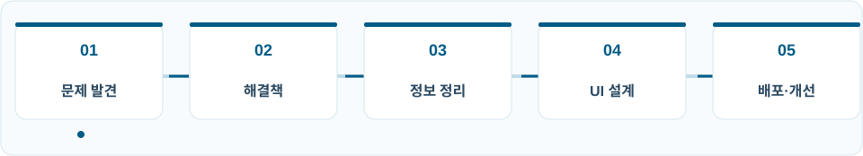

<!-- MinXuan GitHub Profile | GitHub-compatible Markdown & self-hosted animated SVG assets -->

  
  
  
  

🌐 <a href="../README.md">繁體中文</a> &nbsp; | &nbsp; <a href="./en.md">English</a> &nbsp; | &nbsp; <a href="./ja.md">日本語</a> &nbsp; | &nbsp; <a href="./ko.md"><strong>한국어</strong></a>

##  소개

대만 샤오류추 출신 웹 개발자이자 디지털 크리에이터이며 **LiuqiuNow** 설립자입니다. 웹사이트, 정보 시스템, 사용하기 쉬운 디지털 경험을 만드는 것을 좋아합니다.

실생활에서 겪는 문제를 관찰하고, 자료 조사와 정보 통합, 직관적인 인터페이스 디자인을 통해 복잡한 정보를 쉽게 사용할 수 있는 도구로 바꾸는 일을 좋아합니다.

현재 **LiuqiuNow**를 개발하고 운영하며 샤오류추의 여객선 운항, 해상 상황, 실시간 선박 위치와 지역 생활 정보를 통합하고 있습니다. 사진 촬영, 이미지 편집, 시각 디자인에도 관심이 많으며 실제로 사람들에게 도움이 되는 결과물을 만들고 싶습니다.

##  기술 및 도구

<table>
<tr>
<td width="50%" valign="top"><strong>프런트엔드</strong>
 HTML5&nbsp; &nbsp;  CSS3&nbsp; &nbsp;  JavaScript&nbsp; &nbsp;  RWD
</td>
<td width="50%" valign="top"><strong>개발 및 배포</strong>
 VS Code&nbsp; &nbsp;  Git&nbsp; &nbsp;  GitHub&nbsp; &nbsp;  Cloudflare&nbsp; &nbsp;  Cloudflare Workers
</td>
</tr>
<tr>
<td width="50%" valign="top"><strong>데이터 연동</strong>
 Google Apps Script&nbsp; &nbsp;  REST API&nbsp; &nbsp;  JSON&nbsp; &nbsp;  Google Sheets&nbsp; &nbsp;  PWA
</td>
<td width="50%" valign="top"><strong>디자인 및 영상</strong>
 Photoshop&nbsp; &nbsp;  Premiere Pro&nbsp; &nbsp;  Illustrator&nbsp; &nbsp;  Lightroom
</td>
</tr>
<tr>
<td width="50%" valign="top"><strong>웹 최적화</strong>
 SEO / GEO&nbsp; &nbsp;  UI/UX&nbsp; &nbsp;  Responsive Design&nbsp; &nbsp;  API Integration
</td>
<td width="50%" valign="top"><strong>학습 및 도입 중</strong>
 Python&nbsp; &nbsp;  Firebase
Python: 학습 중; Firebase: 도입 중. 경험에 따라 갱신합니다.</td>
</tr>
</table>

##  주요 프로젝트

###  琉急式｜LiuqiuNow

샤오류추 여행자와 지역 주민들이 유용한 정보를 편리하게 확인할 수 있는 실시간 지역 정보 플랫폼입니다.

**[liuqiunow.com](https://liuqiunow.com)**

<table>
<tr><td width="56" valign="middle"></td><td><strong>실시간 해상 정보</strong> 해상 상태, 바람, 해상 예보를 확인할 수 있습니다. <a href="https://sea.liuqiunow.com">sea.liuqiunow.com</a></td></tr>
<tr><td width="56" valign="middle"></td><td><strong>실시간 여객선</strong> 여객선 시간표, 운항 변경 및 승선 정보를 제공합니다. <a href="https://ferry.liuqiunow.com">ferry.liuqiunow.com</a></td></tr>
<tr><td width="56" valign="middle"></td><td><strong>실시간 선박</strong> 지도에서 선박 위치와 이동 상황을 볼 수 있습니다. <a href="https://ships.liuqiunow.com">ships.liuqiunow.com</a></td></tr>
</table>

##  개발 과정

실제 필요한 점을 파악하고, 도움이 되는 해결책을 마련하고, 데이터를 검증·통합하여 사용하기 쉬운 화면을 설계합니다. 배포 후에도 계속 개선합니다.

##  개발 기록

GitHub에 웹 개발, 정보 통합과 실용적인 도구 제작 과정을 기록합니다. 프로젝트 개수보다 실제 문제 해결을 중요하게 생각합니다.

**[GitHub 저장소 보기](https://github.com/hehe6272?tab=repositories)**

##  연락 및 링크

  <a href="https://minxuan.pages.dev/">개인 웹사이트</a> &nbsp;·&nbsp;
  <a href="https://liuqiunow.com">LiuqiuNow</a> &nbsp;·&nbsp;
  <a href="https://youtube.com/@MinXuan_tw">YouTube</a> &nbsp;·&nbsp;
  <a href="https://github.com/hehe6272">GitHub</a>

Discord: .minxuan20061009

아이디어를 일상에 도움이 되는 도구로.

