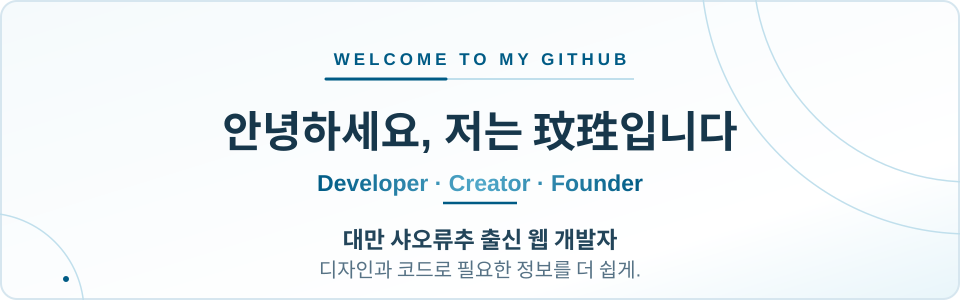
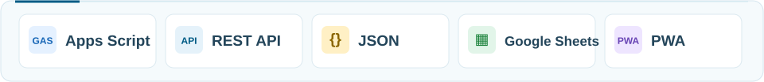
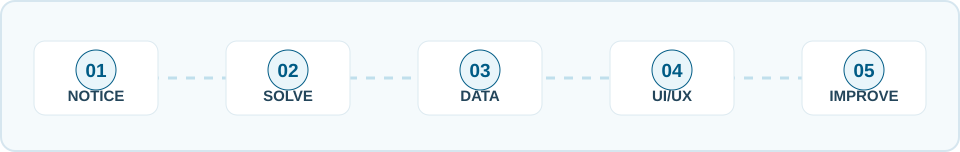

<!-- GitHub Profile V6 · self-hosted responsive light/dark visual system -->

<a href="https://minxuan.pages.dev/"><picture>
    <source media="(max-width: 600px) and (prefers-color-scheme: dark)" srcset="../assets/v6/hero-ko-mobile-dark.svg">
    <source media="(max-width: 600px)" srcset="../assets/v6/hero-ko-mobile-light.svg">
    <source media="(prefers-color-scheme: dark)" srcset="../assets/v6/hero-ko-desktop-dark.svg">
    
  </picture></a>

   

🌐 &nbsp; <a href="../README.md">繁體中文</a> &nbsp;·&nbsp; <a href="./en.md">English</a> &nbsp;·&nbsp; <a href="./ja.md">日本語</a> &nbsp;·&nbsp; <a href="./ko.md"><strong>한국어</strong></a>

## 소개

저는 대만 핑둥 샤오류추 출신의 웹 개발자이자 디지털 크리에이터이며 **LiuqiuNow** 설립자입니다. 흩어진 정보를 누구나 쉽게 활용할 수 있는 서비스로 정리하는 것을 좋아합니다.

현재 여객선 운항, 해상 상황, 실시간 선박 위치, 지역 생활 정보를 통합하는 웹사이트를 개발하고 있습니다. 사진, 이미지 편집, UI/UX 디자인에도 관심이 많으며 실제로 도움이 되는 작품을 만들고자 합니다.

<picture>
    <source media="(max-width: 600px) and (prefers-color-scheme: dark)" srcset="../assets/v6/divider-mobile-dark.svg">
    <source media="(max-width: 600px)" srcset="../assets/v6/divider-mobile-light.svg">
    <source media="(prefers-color-scheme: dark)" srcset="../assets/v6/divider-desktop-dark.svg">
    
  </picture>

## 기술 및 도구

### 프런트엔드

<picture>
    <source media="(max-width: 600px) and (prefers-color-scheme: dark)" srcset="../assets/v6/tech-1-mobile-dark.svg">
    <source media="(max-width: 600px)" srcset="../assets/v6/tech-1-mobile-light.svg">
    <source media="(prefers-color-scheme: dark)" srcset="../assets/v6/tech-1-desktop-dark.svg">
    
  </picture>

### 개발 및 배포

<picture>
    <source media="(max-width: 600px) and (prefers-color-scheme: dark)" srcset="../assets/v6/tech-2-mobile-dark.svg">
    <source media="(max-width: 600px)" srcset="../assets/v6/tech-2-mobile-light.svg">
    <source media="(prefers-color-scheme: dark)" srcset="../assets/v6/tech-2-desktop-dark.svg">
    
  </picture>

### 데이터·시스템 연동

<picture>
    <source media="(max-width: 600px) and (prefers-color-scheme: dark)" srcset="../assets/v6/tech-3-mobile-dark.svg">
    <source media="(max-width: 600px)" srcset="../assets/v6/tech-3-mobile-light.svg">
    <source media="(prefers-color-scheme: dark)" srcset="../assets/v6/tech-3-desktop-dark.svg">
    
  </picture>

### 디자인 및 영상

<picture>
    <source media="(max-width: 600px) and (prefers-color-scheme: dark)" srcset="../assets/v6/tech-4-mobile-dark.svg">
    <source media="(max-width: 600px)" srcset="../assets/v6/tech-4-mobile-light.svg">
    <source media="(prefers-color-scheme: dark)" srcset="../assets/v6/tech-4-desktop-dark.svg">
    
  </picture>

### 웹 최적화

<picture>
    <source media="(max-width: 600px) and (prefers-color-scheme: dark)" srcset="../assets/v6/tech-5-mobile-dark.svg">
    <source media="(max-width: 600px)" srcset="../assets/v6/tech-5-mobile-light.svg">
    <source media="(prefers-color-scheme: dark)" srcset="../assets/v6/tech-5-desktop-dark.svg">
    
  </picture>

### 학습 및 도입 중

<picture>
    <source media="(max-width: 600px) and (prefers-color-scheme: dark)" srcset="../assets/v6/tech-6-mobile-dark.svg">
    <source media="(max-width: 600px)" srcset="../assets/v6/tech-6-mobile-light.svg">
    <source media="(prefers-color-scheme: dark)" srcset="../assets/v6/tech-6-desktop-dark.svg">
    
  </picture>

Python: 학습 중 · Firebase: 도입 및 연동 중.

<picture>
    <source media="(max-width: 600px) and (prefers-color-scheme: dark)" srcset="../assets/v6/divider-mobile-dark.svg">
    <source media="(max-width: 600px)" srcset="../assets/v6/divider-mobile-light.svg">
    <source media="(prefers-color-scheme: dark)" srcset="../assets/v6/divider-desktop-dark.svg">
    
  </picture>

## 주요 프로젝트

### 琉急式 · LiuqiuNow

샤오류추 여행 및 지역 생활을 위한 실시간 정보 통합 플랫폼입니다.

<a href="https://liuqiunow.com"><picture>
    <source media="(max-width: 600px) and (prefers-color-scheme: dark)" srcset="../assets/v6/featured-mobile-dark.svg">
    <source media="(max-width: 600px)" srcset="../assets/v6/featured-mobile-light.svg">
    <source media="(prefers-color-scheme: dark)" srcset="../assets/v6/featured-desktop-dark.svg">
    
  </picture></a>

#### [실시간 해상 정보](https://sea.liuqiunow.com)

<a href="https://sea.liuqiunow.com"><picture>
    <source media="(max-width: 600px) and (prefers-color-scheme: dark)" srcset="../assets/v6/project-1-mobile-dark.svg">
    <source media="(max-width: 600px)" srcset="../assets/v6/project-1-mobile-light.svg">
    <source media="(prefers-color-scheme: dark)" srcset="../assets/v6/project-1-desktop-dark.svg">
    
  </picture></a>

해상 상태, 바람, 해상 예보.

#### [실시간 여객선](https://ferry.liuqiunow.com)

<a href="https://ferry.liuqiunow.com"><picture>
    <source media="(max-width: 600px) and (prefers-color-scheme: dark)" srcset="../assets/v6/project-2-mobile-dark.svg">
    <source media="(max-width: 600px)" srcset="../assets/v6/project-2-mobile-light.svg">
    <source media="(prefers-color-scheme: dark)" srcset="../assets/v6/project-2-desktop-dark.svg">
    
  </picture></a>

운항 일정, 변경 사항, 승선 정보.

#### [실시간 선박](https://ships.liuqiunow.com)

<a href="https://ships.liuqiunow.com"><picture>
    <source media="(max-width: 600px) and (prefers-color-scheme: dark)" srcset="../assets/v6/project-3-mobile-dark.svg">
    <source media="(max-width: 600px)" srcset="../assets/v6/project-3-mobile-light.svg">
    <source media="(prefers-color-scheme: dark)" srcset="../assets/v6/project-3-desktop-dark.svg">
    
  </picture></a>

지도에서 선박 위치와 이동 정보 제공.

<picture>
    <source media="(max-width: 600px) and (prefers-color-scheme: dark)" srcset="../assets/v6/divider-mobile-dark.svg">
    <source media="(max-width: 600px)" srcset="../assets/v6/divider-mobile-light.svg">
    <source media="(prefers-color-scheme: dark)" srcset="../assets/v6/divider-desktop-dark.svg">
    
  </picture>

## 개발 과정

<picture>
    <source media="(max-width: 600px) and (prefers-color-scheme: dark)" srcset="../assets/v6/workflow-mobile-dark.svg">
    <source media="(max-width: 600px)" srcset="../assets/v6/workflow-mobile-light.svg">
    <source media="(prefers-color-scheme: dark)" srcset="../assets/v6/workflow-desktop-dark.svg">
    
  </picture>

**문제 발견 → 해결책 → 자료 정리 → UI 설계 → 배포·개선**

실제 필요한 문제를 파악하고 해결책을 찾은 다음, 자료를 검증·정리하고 쉽게 사용할 수 있는 화면을 설계합니다. 배포 후에도 개선을 계속합니다.

<picture>
    <source media="(max-width: 600px) and (prefers-color-scheme: dark)" srcset="../assets/v6/divider-mobile-dark.svg">
    <source media="(max-width: 600px)" srcset="../assets/v6/divider-mobile-light.svg">
    <source media="(prefers-color-scheme: dark)" srcset="../assets/v6/divider-desktop-dark.svg">
    
  </picture>

## 개발 기록

GitHub에 웹 개발, 시스템 연동, 실용적인 도구의 제작 과정을 기록하고 있습니다. 프로젝트 개수보다 실제 문제 해결을 중요하게 생각합니다.

**[GitHub 저장소 보기](https://github.com/hehe6272?tab=repositories)**

## 링크

<a href="https://minxuan.pages.dev/">개인 웹사이트</a> &nbsp;·&nbsp; <a href="https://liuqiunow.com">LiuqiuNow</a> &nbsp;·&nbsp; <a href="https://youtube.com/@MinXuan_tw">YouTube</a> &nbsp;·&nbsp; <a href="https://github.com/hehe6272">GitHub</a>

Discord: .minxuan20061009

<picture>
    <source media="(max-width: 600px) and (prefers-color-scheme: dark)" srcset="../assets/v6/footer-mobile-dark.svg">
    <source media="(max-width: 600px)" srcset="../assets/v6/footer-mobile-light.svg">
    <source media="(prefers-color-scheme: dark)" srcset="../assets/v6/footer-desktop-dark.svg">
    
  </picture>

아이디어를 유용한 도구로.

